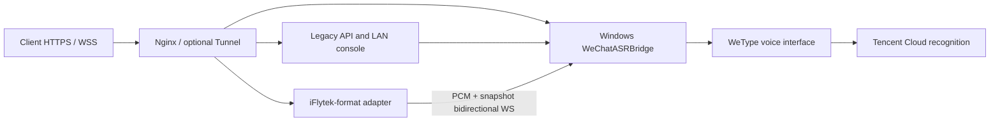

# WeType ASR Gateway

[中文](README.md) | **English**

**v0.2.0: genuine streaming recognition.** The companion Windows bridge 0.3.4 and Linux gateway have passed server tests and live CAM speech acceptance with WeType 3.0.0.38, including draft updates during recording. See the [Release](https://github.com/h9647123/wetype-asr-gateway/releases/tag/v0.2.0), [acceptance scope](docs/acceptance-20261114.md), and [upgrade guide](docs/streaming.md).

Expose Windows WeType speech recognition through an Ubuntu gateway as file-based ASR and an iFlytek V2-style WebSocket API, with a LAN operations console.

This project provides deployment and protocol adaptation. The actual WeType voice bridge is provided by [kuxiaowo/wechat-asr-bridge](https://github.com/kuxiaowo/wechat-asr-bridge); **this project does not implement its own recognition engine**. Recognition requires a Tencent Cloud connection. It is not an offline model and does not require an iFlytek Cloud account.

## Features

- Retains `POST /api/asr` for multipart files and JSON base64 uploads.
- Exposes the upstream OpenAI-style `/v1/models` and `/v1/audio/transcriptions` through Nginx, using the `wetype-voice` model.
- `WS /v1`: iFlytek V2-style HMAC-SHA256 authentication, audio frame statuses 0/1/2, and base64-encoded results. With 16 kHz / mono / 16-bit PCM, clients can receive revisable full-transcript drafts before recording ends.
- LAN console: API key permissions and usage, hidden credentials by default, automatic health checks, failure details, and optional ASR / Search restart buttons.
- Companion Windows SYSTEM startup task and Linux systemd / Nginx examples; an existing blog home page can be retained.
- Optional Bing RSS Search wrapper returning Tavily-style JSON; it is neither the official Tavily service nor SearXNG.

## Capabilities and limits

**The v0.2.0 real-time path requires the companion stream-capable Windows portable bridge 0.3.4.** Upgrading only the Linux gateway while keeping the unextended upstream 0.3.3 is insufficient. Extension source and reproducible provenance are provided with this project. For installation and upgrades, see [Windows setup](docs/windows.md) and [Streaming](docs/streaming.md).

16 kHz / mono / 16-bit raw PCM is recognized as it arrives over bidirectional WebSocket. Intermediate results are replaceable full-transcript drafts, and a native end marker confirms the final result. Text is not guaranteed for every character or audio packet. Other supported PCM formats are buffered in full and transcribed over HTTP. Total audio duration is limited to 60 seconds, including the recording tail. MP3/lame, hotwords, speaker diarization, and precise timestamps are not supported. The OpenAI file endpoint and legacy `/api/asr` remain available, with upstream decoding and a 25 MiB limit. The public edition **does not write audio archives**; audio and diagnostic frame timings remain in request memory only.

Language and accent parameters cannot force WeType to change recognition behavior. The upstream relies on internal interfaces that may break after upgrades. The tested versions and results below are acceptance records, not guarantees for other versions or recognition accuracy.



## Quick start

Requires **Python 3.12**. The current console uses the standard-library `cgi` module, so Python 3.13 and later are not currently supported. Install the Windows bridge and Linux gateway separately. Starting this repository alone does not create a Windows VM or install the recognition engine.

```bash
git clone https://github.com/h9647123/wetype-asr-gateway.git
cd wetype-asr-gateway
python3.12 -m venv .venv
.venv/bin/pip install -r requirements.txt

# Replace VM_IP with the private address of the dedicated Windows VM.
.venv/bin/python scripts/init_config.py --upstream http://VM_IP:8765
```

Initialization creates a Git-ignored `data/` directory with mode 700 and files with mode 600. It contains private configuration, the console token, key digests, and `bridge-api-key.txt`. **Repeated initialization refuses to overwrite existing credentials.** Use the same bridge key on Windows; see [Windows installation](docs/windows.md). To reuse an existing bridge key, pass `--upstream-key-file /private/key.txt`.

Run in two separate terminals:

```bash
# Terminal 1: listens only on 127.0.0.1:18080 by default.
.venv/bin/python -m gateway.console

# Terminal 2: listens only on 127.0.0.1:8768 by default.
# Disable access logs to avoid recording signed URLs.
.venv/bin/python -m uvicorn gateway.iat:app --host 127.0.0.1 --port 8768 \
  --no-access-log --ws-max-size 1048576 --ws-max-queue 4 --limit-concurrency 12
```

Generate a login link locally and open it in your browser. The link contains administrative credentials; do not share it, include it in screenshots, or write it to ordinary logs:

```bash
.venv/bin/python scripts/console_url.py
```

Select **ASR** to view configuration. Select **API keys** to view health and create client keys with `asr` / `search` scopes. Restart permission is not granted by default, and the button shows “Restart not enabled.” See [Deployment and administration](docs/deployment.md) to enable it.

## API examples

Assume Nginx is configured at `https://asr.example.com`. Keys in environment variables should come from private configuration; the examples below contain no usable credentials.

```bash
# OpenAI-style API: use the dedicated bridge key from the ASR page.
curl https://asr.example.com/v1/audio/transcriptions \
  -H "Authorization: Bearer $WETYPE_ASR_API_KEY" \
  -F model=wetype-voice -F file=@recording.wav

# Legacy API: use a console key with the asr scope.
curl https://asr.example.com/api/asr \
  -H "Authorization: Bearer $ASR_CLIENT_KEY" -F file=@recording.wav

# iFlytek-format example: reads private local config.json without printing
# keys or signed URLs.
.venv/bin/python scripts/iat_client.py recording.wav data/config.json

# Simulate real-time audio and display changing full-transcript drafts.
# This prints recognized text.
.venv/bin/python scripts/iat_client.py recording.wav data/config.json --realtime --partials
```

For a public deployment, initialization can include `--public-base https://asr.example.com`. For an existing configuration, back it up and edit `legacy_url`, `openai_base_url`, and `iat_url`; do not regenerate keys. The backend `upstream` remains the private VM address and should not loop back through the public internet.

See [Protocol](docs/protocol.md) for signatures, frame formats, and explicitly unsupported parameters. See [Deployment and administration](docs/deployment.md) for Linux startup, restricted restart permissions, and Nginx configuration that preserves an existing blog.

## References and attribution

| Source | Role in this project | License / notes |
|---|---|---|
| [kuxiaowo/wechat-asr-bridge](https://github.com/kuxiaowo/wechat-asr-bridge) | **Actual ASR backend**: Windows portable bridge, OpenAI-style file API, and WeType voice bridging; this repository adds deployment, streaming extensions, and protocol adaptation | MIT; prototype v0.3.3, research baseline commit `bce9b6b4825e6fb8c7a9d0d02a0d31a90dd3d2f2`; companion releases provide a custom extended portable build, retain upstream attribution, and contain no Tencent components |
| [yu1745/wetype-ime-linux](https://github.com/yu1745/wetype-ime-linux) | Reference for Linux WeType feasibility research; **not a runtime dependency, and its implementation was not copied** | GPL-3.0; research commit `3a127ef2cb5a9d9754e6307f462b188d8f31b878` |
| [iFlytek real-time speech transcription V2 documentation](https://www.xfyun.cn/doc/spark/spark_zh_iat_new.html) | Reference for HMAC signatures and WebSocket data formats | Only the documented local subset is implemented; no dependency on iFlytek Cloud credentials, accounts, or quota |
| [modelscope/FunASR](https://github.com/modelscope/FunASR/blob/main/README_zh.md) | Public Chinese sample audio listed in the official documentation, used for public-network acceptance | Only the source and test results are referenced; no models, audio, or FunASR source are bundled |
| [Official WeType website](https://z.weixin.qq.com/) | Source of the Windows WeType installer | Proprietary software; obtain it yourself and comply with its license; it is not distributed with this repository |

For full attribution and distribution boundaries, see [THIRD_PARTY_NOTICES.md](THIRD_PARTY_NOTICES.md). This project is not an official Tencent or iFlytek product.

## Validation status

The deployment prototype passed real acceptance tests on Ubuntu 24.04 / KVM, Windows 10 Enterprise LTSC 2021, WeType 3.0.0.38, and WeChatASRBridge 0.3.3:

- Complete transcription of 6.28-second test audio and 43.96-second repeated audio; recognition still worked after a VM restart without desktop login.
- A downloaded 5.547-second Chinese sample returned the same complete transcript through public OpenAI-style, legacy, and WSS endpoints.
- Missing keys, incorrect HMACs, incorrect App IDs, and public administration requests were rejected. Public transcription was rechecked after restart operations.
- Deployment logs, real domains, IPs, credentials, screenshots, and VM images are not published.

This repository parameterizes the prototype configuration and restricts optional restart permissions. Offline automated tests do not call Tencent Cloud. Real-environment results and CI scope are recorded separately; see [Verification](docs/verification.md).

Streaming research also used public prerecorded audio with local WeType 3.0.1.35 to verify 500 ms packets, a persistent encoder, intermediate text before recording ended, and final-end confirmation. This does not establish acceptance for arbitrary versions, live microphones, all public-network conditions, or 60-second recordings. Upgrading the gateway does not automatically change the existing VM's WeType version.

```bash
.venv/bin/pip install -r requirements-dev.txt
.venv/bin/python -m pytest
```

## License

Original code in this repository uses [MIT](LICENSE). Upstream projects and Windows / WeType retain their own licenses. Users must provide a Windows environment they are legally entitled to use. This repository supplies no installation images, activation keys, or activation bypasses.
