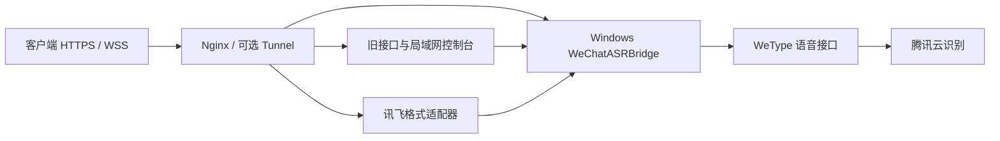

# WeType ASR Gateway

把 Windows 微信输入法的语音识别，通过 Ubuntu 网关接成文件 ASR 和讯飞 V2 风格的 WebSocket 接口，并提供局域网运维控制台。

本项目是部署与协议适配层。实际微信语音桥接由 [kuxiaowo/wechat-asr-bridge](https://github.com/kuxiaowo/wechat-asr-bridge) 提供，**不是本项目自行实现的识别引擎**。识别需要腾讯云连接，不是离线模型，也不需要讯飞云账户。

## 能做什么

- 保留 `POST /api/asr`：multipart 文件和 JSON base64 上传。
- 通过 Nginx 暴露上游 OpenAI 风格的 `/v1/models`、`/v1/audio/transcriptions`，模型为 `wetype-voice`。
- `WS /v1`：讯飞 V2 风格 HMAC-SHA256 鉴权、0/1/2 分段音频和 base64 编码结果。
- 局域网控制台：API key 权限和用量、默认隐藏凭据、自动健康检查、失败详情、可选的 ASR / Search 重启按钮。
- 配套 Windows SYSTEM 开机任务、Linux systemd / Nginx 示例，现有博客首页可以保留。
- 可选 Bing RSS Search wrapper，输出 Tavily 风格 JSON；它不是 Tavily 官方服务或 SearXNG。

## 能力边界

WebSocket **先缓存音频，结束后返回一次最终全文**，没有实时逐字结果、动态修正、热词、说话人分离或精确时间戳。仅支持 raw PCM：8/16 kHz，1/2 声道，8/16 bit，最长 60 秒；不支持 MP3/lame。OpenAI 文件接口由上游负责解码，最大 25 MiB。

语言和口音参数不能强制切换 WeType 识别行为。上游依赖内部接口，升级可能失效。下面列出的实测版本与结果只是验收记录，不是对其他版本或识别准确率的保证。



## 快速开始

需要 **Python 3.12**。现有控制台使用标准库 `cgi`，Python 3.13 及以上当前不支持。Windows 桥接器与 Linux 网关分别安装；仅启动本仓库不会自动创建 Windows VM 或安装识别引擎。

```bash
git clone https://github.com/h9647123/wetype-asr-gateway.git
cd wetype-asr-gateway
python3.12 -m venv .venv
.venv/bin/pip install -r requirements.txt

# VM_IP 替换为专用 Windows 虚拟机的私有地址
.venv/bin/python scripts/init_config.py --upstream http://VM_IP:8765
```

初始化会生成被 Git 忽略的 `data/`，目录 700、文件 600，包含私有配置、console token、key 摘要和 `bridge-api-key.txt`。**重复初始化会拒绝覆盖现有凭据**。在 Windows 中使用同一个桥接 key，参见 [Windows 安装](docs/windows.md)。已有桥接 key 时可传 `--upstream-key-file /private/key.txt`。

分别在两个终端运行：

```bash
# 终端 1：默认只监听 127.0.0.1:18080
.venv/bin/python -m gateway.console

# 终端 2：默认只监听 127.0.0.1:8768，关闭访问日志以免记录签名 URL
.venv/bin/python -m uvicorn gateway.iat:app --host 127.0.0.1 --port 8768 \
  --no-access-log --ws-max-size 1048576 --ws-max-queue 4 --limit-concurrency 12
```

在本机生成登录链接并在浏览器打开。链接包含管理凭据，勿分享、截图或写入普通日志：

```bash
.venv/bin/python scripts/console_url.py
```

选择 **ASR** 查看配置；选择 **API keys** 查看健康、创建带 `asr` / `search` scope 的调用 key。开箱默认不授予重启权限，按钮显示“重启未启用”。启用方式见 [部署与管理](docs/deployment.md)。

## 接口示例

假设已将 Nginx 配置到 `https://asr.example.com`。环境变量中的 key 应由私有配置读取，下面没有可用的实际凭据。

```bash
# OpenAI 风格；使用 ASR 页的桥接专用 key
curl https://asr.example.com/v1/audio/transcriptions \
  -H "Authorization: Bearer $WETYPE_ASR_API_KEY" \
  -F model=wetype-voice -F file=@recording.wav

# 旧接口；使用拥有 asr scope 的控制台 key
curl https://asr.example.com/api/asr \
  -H "Authorization: Bearer $ASR_CLIENT_KEY" -F file=@recording.wav

# 讯飞格式示例，读取本机私有 config.json，不打印密钥或签名 URL
.venv/bin/python scripts/iat_client.py recording.wav data/config.json
```

公网初始化可添加 `--public-base https://asr.example.com`。已有配置应在备份后编辑 `legacy_url`、`openai_base_url`、`iat_url`，不要重新生成 key。后端 `upstream` 仍为私有 VM 地址，不应绕到公网。

签名、帧格式与明确不支持的参数见 [协议说明](docs/protocol.md)。Linux 开机启动、受限重启权限和保留博客的 Nginx 配置见 [部署与管理](docs/deployment.md)。

## 参考项目与来源

| 来源 | 本项目中的作用 | 许可证 / 说明 |
|---|---|---|
| [kuxiaowo/wechat-asr-bridge](https://github.com/kuxiaowo/wechat-asr-bridge) | **实际 ASR 后端**：Windows portable bridge、OpenAI 风格文件接口、WeType 语音桥接；本仓库提供外围部署与协议适配 | MIT；实测 v0.3.3，调研提交 `bce9b6b4825e6fb8c7a9d0d02a0d31a90dd3d2f2`；不打包其二进制 |
| [yu1745/wetype-ime-linux](https://github.com/yu1745/wetype-ime-linux) | Linux 微信输入法可行性调研参考；**不作为本项目运行依赖，没有复制其实现** | GPL-3.0；调研提交 `3a127ef2cb5a9d9754e6307f462b188d8f31b878` |
| [讯飞实时语音转写 V2 文档](https://www.xfyun.cn/doc/spark/spark_zh_iat_new.html) | HMAC 签名和 WebSocket 数据格式参考 | 本地只实现列出的协议子集；无讯飞云凭据、账户或额度依赖 |
| [modelscope/FunASR](https://github.com/modelscope/FunASR/blob/main/README_zh.md) | 官方文档列出的公开中文示例音频，用于公网验收 | 仅引用来源和测试结果，不打包模型、音频或 FunASR 源码 |
| [微信输入法官网](https://z.weixin.qq.com/) | Windows 微信输入法安装包来源 | 专有软件，需自行获取并遵守其许可；不随本仓库分发 |

完整归属和分发边界见 [THIRD_PARTY_NOTICES.md](THIRD_PARTY_NOTICES.md)。项目不是腾讯或讯飞的官方产品。

## 验证状态

部署原型在 Ubuntu 24.04 / KVM、Windows 10 Enterprise LTSC 2021、WeType 3.0.0.38、WeChatASRBridge 0.3.3 上完成了真实验收：

- 6.28 秒测试音频、43.96 秒重复音频完整转写；VM 重启后无需桌面登录仍可识别。
- 网上下载的 5.547 秒中文示例，通过公网 OpenAI、旧接口、WSS 三种方式都返回相同全文。
- 拒绝无 key、错误 HMAC、错误 App ID 和公网管理请求；重启操作完成后重新验证了公网转写。
- 不公开部署日志、实际域名、IP、凭据、截图或虚拟机镜像。

本仓库将原型配置参数化，并收紧可选重启权限。离线自动化测试不调用腾讯云；真实环境结果与 CI 测试范围分开记录，见 [验证说明](docs/verification.md)。

```bash
.venv/bin/pip install -r requirements-dev.txt
.venv/bin/python -m pytest
```

## 许可证

本仓库原创代码采用 [MIT](LICENSE)。上游项目和 Windows / WeType 软件维持各自许可证。使用者需自行提供有合法使用权的 Windows 环境；本仓库不提供安装镜像、激活密钥或激活绕过方法。
